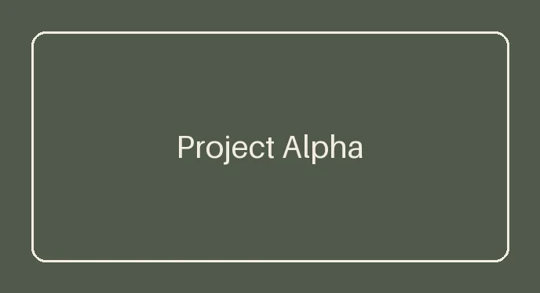

## Overview

Project Alpha is a fictional project created to validate the website's content architecture.

## Design process

This section describes the design and development process.

## Results

This section presents the results of the project.

## Heading level 2

This paragraph tests the editorial typography, text width and spacing between content blocks.

### Heading level 3

#### Heading level 4

##### Heading level 5

###### Heading level 6

This paragraph contains **bold text**, *italic text* and an [external link](https://example.com/).

- First unordered list item
- Second unordered list item
- Third unordered list item

1. First ordered list item
2. Second ordered list item
3. Third ordered list item

> This is an editorial blockquote.

---

## Editorial image

This paragraph appears after the editorial image.