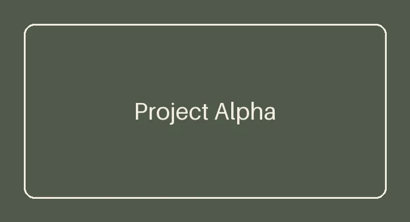

## Visão geral

O Projeto Alpha é um projeto fictício criado para validar a arquitetura de conteúdo do site.

## Processo de design

Esta seção descreve o processo de design e desenvolvimento.

## Resultados

Esta seção apresenta os resultados do projeto.
