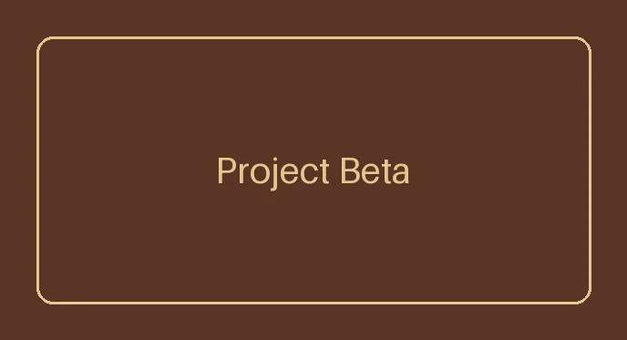

## Overview

Project Beta is a fictional project created to validate MDX support.

## Development

This project combines Markdown content with an embedded JSX element.

MDX expression test: {2 + 2}

