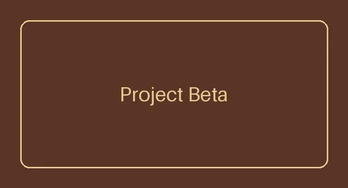

## Visão geral

O Projeto Beta é um projeto fictício criado para validar o suporte a MDX.

## Desenvolvimento

Este projeto combina conteúdo Markdown com um elemento JSX incorporado.

Teste de expressão MDX: {2 + 2}

